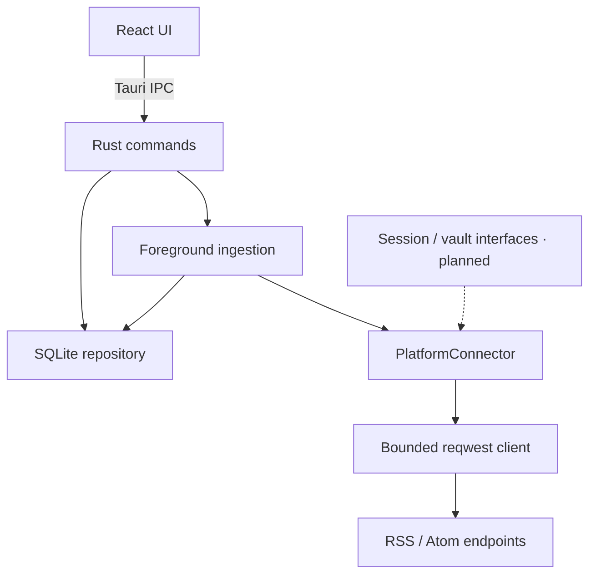

# Architecture · v0.2 implementation

## Decisions

MediaOne is a modular local application: Tauri 2 hosts a React/TypeScript UI and Rust application services. Desktop and mobile clients have equal ingestion responsibilities. No central service, HTTP API server, browser extension, Playwright, cloud database, sync service or Node sidecar is required at runtime.

The UI always reads SQLite. Fetching happens outside database transactions; a successful source batch updates content and its success marker atomically. Read state is separate and is not overwritten on refresh. A per-device mutex prevents overlapping refreshes and serializes unsubscribe against ingestion. Sources are fetched sequentially, with errors reported per source so other sources continue.

Tauri initializes the database in its platform-specific app-data directory. Migrations run before commands become available. The mobile entry point exposes the same services. Every install owns its subscriptions, content and read state. Cross-device sync is deferred.

## Boundaries

- `src/api.ts`: the only frontend IPC wrapper; no frontend platform HTTP calls.
- `models.rs`: serialized camelCase IPC models; TypeScript mirrors these in `src/types.ts`.
- `connectors/`: platform parsing/fetching; normalized output contains the source identity.
- `ingestion.rs`: batch coordination and per-source outcomes.
- `database.rs`: migrations, subscription eligibility, ordering, persistence and deduplication.
- `auth.rs`: account metadata and abstract credential-vault/session extension points.

Only explicitly added subscriptions can supply items; feed queries join the subscription table. Sort order is publication time descending and ID descending. Undated entries use first-fetch time; refresh preserves it. At present, filter/limit reads use offset support internally and the UI expands to 200 items; cursor paging is future work.

## Lifecycle and resource policy

Foreground manual refresh plus a five-minute interval when the page is visible. No guaranteed background execution or OS scheduler is claimed. Requests have a 20-second timeout, five-redirect limit and streamed 5 MiB response limit. No automatic retry loop, ETag/Last-Modified cache, backoff or incremental cursor support is claimed yet. RSS refresh fetches the current document and deduplicates locally.

## Security boundary

Remote documents are data, never UI code. Titles render as escaped React text, and item links are restricted to HTTP(S). A narrow `open_original(id)` command loads the stored URL, validates it again and opens the system browser through the Tauri opener plugin. No arbitrary path-opening capability is exposed. CSP disallows remote scripts, images and connections from the UI. Database and networking are exposed only through narrow application commands. Feed URLs cannot embed credentials; do not use secret-bearing feed URLs because URLs are stored locally in plaintext. Local/private-network HTTP feeds are intentionally allowed for a personal local client; there is no server-side proxy.

The database contains account metadata only. The credential-vault trait has no plaintext fallback or production implementation. OAuth PKCE, Keychain/Keystore, cookie lifetimes, scope handling and revocation must be implemented before authenticated connectors are enabled. System browser, WebView and Rust HTTP cookies are separate stores; no session sharing is assumed.

## References

- [Tauri project setup](https://v2.tauri.app/start/create-project/)
- [Tauri Rust commands](https://v2.tauri.app/develop/calling-rust/)
- [Tauri mobile development](https://v2.tauri.app/start/prerequisites/)
